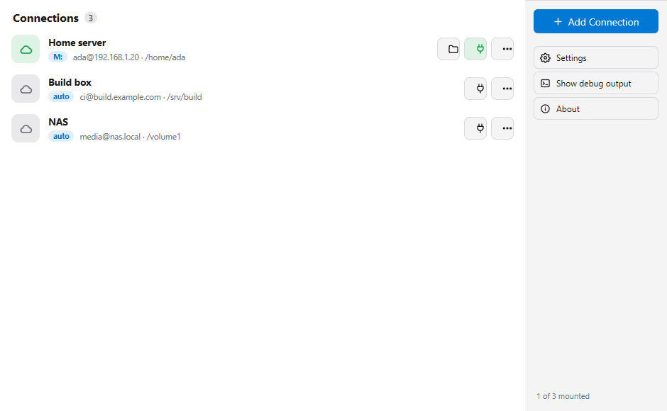
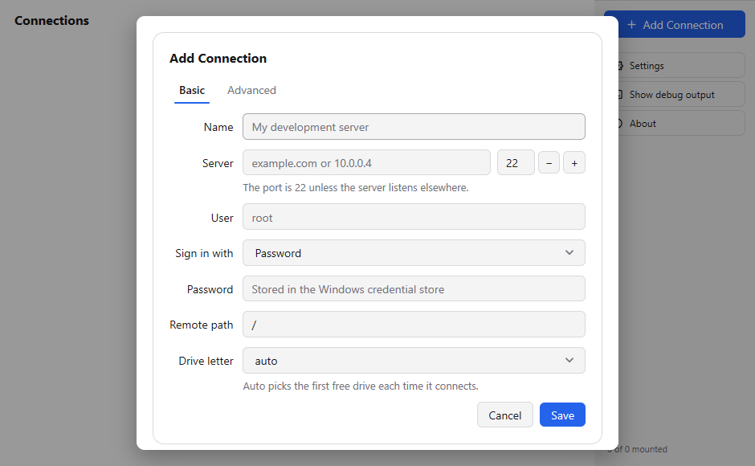

# SSHFS Drive

把 SSH 服务器挂成 Windows 盘符的小工具，用
[MyGo](https://github.com/egoist/mygo) 写的：界面由 Go 直接绘制到 GPU（Windows 上是
Direct3D 11），没有 webview、没有 Node、没有前端构建，产出一个单文件 exe。

挂载本身也不再调 `sshfs.exe`：SSH 连接、SFTP 会话和文件系统逻辑全在这个进程里，
用 `golang.org/x/crypto/ssh` + `pkg/sftp` 实现，再经 [WinFsp](https://winfsp.dev) 的
FUSE 层变成一个盘符。**WinFsp 是唯一的外部依赖**，`sshfs.exe` 和 `ssh.exe` 都不再需要。



## 与 Electron 版 / 上一版的对照

| | Electron 版 | MyGo 版 v1（调 sshfs） | 这一版 |
|---|---|---|---|
| 界面 | Chromium 渲染 HTML/CSS | `mygo/ui` 原生控件 | 同左 |
| 挂载 | `sshfs.exe` + `ssh.exe` 子进程 | 同左 | 本进程内 SSH+SFTP，WinFsp 出盘符 |
| 外部依赖 | SSHFS-Win（含 WinFsp）+ OpenSSH | 同左 | 只有 WinFsp |
| 密码存放 | 明文 JSON | Windows 凭据管理器 | 同左 |
| 调试输出 | 拦截 `console.log` | 解析 sshfs 的 stderr | 自己的连接/会话日志 + 操作错误 |
| cgo | — | — | 无（cgofuse 的 `!cgo` 变体） |

功能一一对得上：连接列表与状态、连接/断开/打开盘符、拖拽排序、复制连接、删除确认、
三种认证方式（密码 / 每次询问 / 私钥文件）、开机自动挂载、开机自启、关闭到托盘、调试面板、
只读挂载、属性缓存时长。

## 用起来

1. 安装 [WinFsp](https://winfsp.dev/rel/)（一个内核驱动 + 用户态 DLL，装完不用重启）。
   **不需要** SSHFS-Win，也不需要装 OpenSSH 客户端。
2. 跑 `build/windows-amd64/SSHFS Drive.exe`，或安装包。
3. 添加连接，点插头图标挂载。

第一次启动会搬配置，不用重填：先看老 Electron 版留在 `%APPDATA%\sshfs-win-manager\` 的
`vuex.json` / `config.json` / `state.json`，没有的话再看旧版本（改名前的 SSHFS-Win Manager）
留在 `%APPDATA%\SSHFS-Win Manager\config.json` 的那份。密码不在文件里，一直由 Windows
凭据管理器保管，连接 ID 不变所以升级后不用重新输入。

快捷键：`Ctrl+N` 新建连接，`Ctrl+,` 打开设置。



## 代码结构

| 文件 | 内容 |
|---|---|
| `main.go` | 单实例锁、应用生命周期、退出时卸载所有盘符 |
| `app.go` | 状态与行为：连接 / 断开 / 监听挂载退出 / 弹窗开关 / 托盘 |
| `view.go` | 主窗口视图：连接行、状态色、调试面板、侧栏 |
| `dialogs.go` | 添加/编辑（基础 + 高级）、设置、关于、密码询问、删除确认 |
| `model.go` | `Connection` / `Settings`、JSON 持久化、密码进出凭据管理器 |
| `dial.go` | SSH 拨号：密码 / 键盘交互 / 私钥 / ssh-agent，known_hosts 校验，错误翻译 |
| `agent_windows.go` | 走命名管道 `\\.\pipe\openssh-ssh-agent` 读 agent 里的密钥 |
| `remote.go` | `remote` / `remoteFile` 接口，以及 `*sftp.Client` 的适配 |
| `vfs.go` | 文件系统语义：路径映射、属性/目录缓存、大小写折叠、句柄表、读写/改名/删除 |
| `winfs.go` | 把 `vfs` 接到 FUSE 接口：errno 映射、`Stat_t` 组装、目录列举 |
| `mount_windows.go` | 挂载生命周期：选盘符、建会话、`fuse.Mount` 阻塞、keepalive、卸载 |
| `platform_windows.go` | `GetLogicalDrives` 选空盘符、默认私钥路径 |
| `legacy.go` | 老 Electron 版配置的导入 |
| `logbuf.go` | 调试面板的环形日志缓冲（有锁，跨 goroutine） |

几条实现上的取舍：

- **一个进程，两条线程边界。** FUSE 回调来自 WinFsp 的工作线程，所以 `vfs` 全程加锁；
  界面状态只在主线程动，后台结果用 `Window.Update` 回来。
- **属性缓存是性能的关键。** Explorer 打开一个目录会连环 stat。`vfs` 缓存属性、负结果和目录列表
  （默认 20 秒，设置里可调），写入/改名/删除时精确失效受影响的那几项。
- **过期的答案照给，刷新放后台。** 缓存到期不再让调用者等服务器确认：先把手里的旧答案交出去，
  同时在后台重新问一次（同一个路径同时只有一个刷新在跑）。一个几千项的目录，缓存一到期就要被
  逐个重新确认，那正是“资源管理器一卡十几秒”的样子；这一条把它变成瞬时返回。
- **同一个请求只发一次。** Explorer、覆盖图标提供程序、索引器经常同时问同一个目录，
  相同路径的请求合并，后来的直接等前一个的结果。
- **查一个名字先看它所在目录的列表。** 目录列表本身就写着“有哪些名字、服务器用的是哪种大小写”，
  所以列表在手时，存在性、大小写、大小都不必再问服务器；不在列表里的名字直接按“不存在”记进负缓存。
  资源管理器右键一个目录会连环探测 `desktop.ini`、`Thumbs.db`、`.git` 之类的名字，这条把整轮探测
  从“每个名字两趟往返”变成不出网。
- **打开目录不再顺手列举目录。** Windows 每次 `CreateFile` 一个目录（包括只为读属性）都会落到
  `Opendir`，在这里预先 `readdir` 会让“显示一棵有很多子目录的树”变成每个子目录一次完整列举。
  现在 `Opendir` 只确认它是目录，`Readdir` 才去列举，之后再命中缓存。
- **打开文件是惰性的。** Windows 为了读属性会打开文件（Go 的 `os.Stat`、资源管理器取图标都这样）。
  句柄先记下来，第一次真读写真才向服务器发 OPEN，释放时若没读过也不发 CLOSE。
  这一条把“列一个 300 个文件的目录”从 2.5 秒降到 14 毫秒。
- **不给新文件补 chmod。** 建文件/建目录后不再多打一次 CHMOD 往返，权限交给服务器自己的 umask。
- **大小写折叠不重复问。** 逐段折叠时先查属性缓存，深路径上不会每个目录都打一次 stat。
- **改名搬属性。** 改名后新名字的属性从旧名字的缓存带过来，不再回服务器补一次 stat。
- **卷容量缓存 30 秒。** Explorer 每次列盘符都会问剩余空间，`statvfs` 不必每次都走一趟。
- **WinFsp 的元数据缓存跟着应用设置走。** 默认它只记 1 秒就重问，现在 `FileInfoTimeout` 取
  属性缓存时长（上限 20 秒），`VolumeInfoTimeout` 60 秒。
- **大小写折叠。** Windows 应用常把 `README.md` 写成 `readme.md`；`vfs` 在 ENOENT 时逐段按
  `EqualFold` 找服务器上的真实拼写，命中后连缓存一起记住。
- **不断线装死。** 每 15 秒发一次 `keepalive@openssh.com`；失败就主动卸载并报“连接丢失”，
  而不是留一个每次读写都 EIO 的盘符。
- **host key 有底线。** 文件不存在时接受任意 host key（和上一版 `StrictHostKeyChecking=no`
  一致，但会把 SHA-256 指纹写进日志）；`known_hosts` 里已有该主机时严格比对，**指纹变了就拒绝**。
- **密码不进配置文件。** 保存时写进凭据管理器（`mygo.Secrets`）；“每次询问”的连接挂载成功后
  立刻丢弃密码，从不写盘。
- **卸载不留孤儿。** `host.Unmount()` 走 WinFsp 正常退出，进程崩了 WinFsp 也会清理挂载点，
  不再需要 `taskkill /T`。
- **关窗进托盘，退出要退干净。** 点窗口的 X 只是隐藏（`OnClose` 里 `PreventDefault`）；
  但窗口“阻止关闭”会取消整个 quit，所以托盘 Quit 时先置 `quitting` 标志，让窗口真的关掉。
  退出时最多等 1.5 秒让盘符卸载，等不到就直接退——WinFsp 会清理进程留下的挂载点，
  用户点了退出就该退出。

## 开发

```sh
# 需要 Go 1.27+；依赖全在 go.mod 里，直接拉
go build ./...        && GOOS=linux go build ./... && GOOS=darwin go build ./...
go vet ./...
go test ./...         # 视图测试用 ui.NewTester，无需开窗口；挂载层用内存服务器替身
go run .              # 直接跑

# 对真实服务器跑一遍 SSH + SFTP（会用 /tmp 下的临时目录，跑完删掉）
SSHFSMGR_TEST_HOST=192.0.2.10 SSHFSMGR_TEST_USER=user \
  SSHFSMGR_TEST_KEY=~/.ssh/id_ed25519 go test -run TestRealServer -v .

# 打包 exe + 安装包。window、图标和 NSIS 安装包由 MyGo 的 CLI 生成，
# 用 go run 现取，不必把 CLI 的依赖塞进 go.mod。
go run github.com/egoist/mygo/cmd/mygo@v0.10.0 build .
```

测试覆盖：

- `vfs_test.go` — 路径映射到远端目录、属性缓存与超时、负缓存、大小写折叠、读写与偏移、
  多句柄、惰性打开（只查属性不碰服务器）、截断后的缓存大小、改名覆盖已有文件、
  只读拒绝一切修改、statvfs 回落、关闭一次。
- `winfs_test.go` — FUSE 层：`Stat_t` 组装、目录列举（含 `.` / `..` 与属性）、
  创建→写→读→截断→释放、目录增删改、只读挂载的 EROFS、chmod/chown 不报错、errno 映射。
- `sftp_integration_test.go` — 真机：认证、建目录、写、fsync、读、stat、readdir、
  posix-rename 覆盖、utimens、删除。
- `mount_live_test.go` — 真机挂载：盘符出现、`os.WriteFile`/`os.ReadFile`/`os.Rename`/`os.RemoveAll`
  走 Windows 文件 API 穿过整个栈、8 MB 读写、100 个小文件、卸载后盘符消失。
- `perf_integration_test.go` — 同一条链路去掉 WinFsp，用来判断慢在 SFTP 还是 Windows。
- `perf_live_test.go` — 真机浏览基准：readdir、逐项 stat、惰性打开、mkdir，
  用来验证缓存和打开策略的改动是不是真的变快了。
- `probe_hold_test.go` — 把一个盘符按住不放（`SSHFSMGR_HOLD=V:`），同时把调用写到
  `%TEMP%\fs-trace.log`，好用另一个进程（资源管理器、脚本）去打它，看真实场景打了哪些往返。
- `view_test.go` / `debug_layout_test.go` — 空状态、新增/编辑/复制/删除、设置弹窗、
  调试面板与日志复制、深浅色主题（`SNAPSHOT=out.png go test -run TestWindowShowsConnections .`
  可以把窗口渲成 PNG，不开窗口也能看界面）。

## 实测（一台局域网服务器，Ubuntu 24.04 + OpenSSH 9.6）

| 项目 | 数字 | 说明 |
|---|---|---|
| 挂载到盘符可用 | 0.4–0.5 s | 含 SSH 握手、SFTP 会话、WinFsp 建卷 |
| 8 MB 顺序写 / 读 | 9 / 12 MB/s | 裸 `ssh` 管道同一条链路只有 11–13 MB/s，已经跑满 |
| 1000 条目录 readdir | 32 ms | 服务端一次 NAME 响应，客户端没有额外 stat |
| 单个小文件创建 | 9–60 ms 双峰 | WinFsp 下 Defender 实时保护对新文件做按访问扫描（`os.Mkdir` 稳定 9–10 ms，不触发扫描） |

浏览一个 300 个文件 + 20 个子目录的文件夹（`SSHFSMGR_LIVE_HOST=… go test -run TestBenchBrowse -v .`）：

| 操作 | 优化前 | 优化后 |
|---|---|---|
| 逐个 stat（320 项） | 2.57 s（8.02 ms/项） | 14 ms（50 µs/项） |
| 打开一个含 20 个子目录的目录 | 21 次 SFTP 往返 | 1 次（只有那一次 readdir） |
| 逐项取 20 个子目录的属性 | 20 次 readdir | 0 次 |
| 右键/探测 60 个不存在的名字 | 115 次往返（2 次/名字） | 0 次（列表已回答） |
| open + read 4K + close | 46 ms | 7.7 ms |
| 探测 `desktop.ini` 之类不存在的名字 | 570 µs/次 | 20 µs/次 |
| readdir（缓存命中） | 1 ms | 1 ms |
| 缓存到期后重新读一个 3000 项的目录 | 逐项重新确认（3000+ 往返） | 0 次（旧答案直接给，后台刷新） |
| 20 个项目同时问同一个目录 | 20 次往返 | 1 次 |

三个数字背后的结论，都实测过：

- **卡在属性查询，不在带宽。** 优化前每次 stat 都付 `OPEN + CLOSE` 两个 SFTP 往返，因为 Windows
  取属性时会顺手打开文件。改成惰性打开后，属性查询完全不出网。
- **写延迟是服务器侧的，不是客户端。** 一次 32 KB 的 SFTP 写固定约 23 ms，读同样大小只要 4.4 ms
  （裸 SSH 回环 7.7 ms、服务器本地 NVMe 单次写瞬时完成）。用 OpenSSH 自己的 `sftp` 客户端
  传 10 个 32 KB 文件要 914 ms（≈60 ms/个），比这里的 26 ms/个还慢，所以这块没有客户端可优化空间。
- **新建文件那 9–60 ms 是杀软。** 同一文件重复打开 7 ms、新文件 11 ms，`os.Mkdir` 稳定 9–10 ms；
  想要更快可以给盘符加 Defender 排除项，但那是安全策略，由你决定。

**“文件一多就卡死”通常不是本程序在等服务器。** 一个目录的列举只有一次 `readdir`（3000 项 57 ms、
20000 项也不重复不丢项），逐项属性全部由列表回答。真正在盘符上连环出网的是这一类程序：

- **TortoiseGit / TortoiseSVN 的覆盖图标**（`TGitCache.exe` / `TSVNCache.exe`）：看到工作副本就把整棵树
  stat 一遍算图标状态。它们的设置里把盘符加进 *Icon Overlays → Exclude paths*（例如 `D:\*`），
  或把 *Status cache* 设为 `None`，卡顿立刻消失。
- **Windows Defender 实时保护**：任何一次“打开文件”都会触发扫描，扫描是**通过本程序读文件内容**的，
  于是每个文件变成 OPEN+READ 两趟往返。给盘符加排除项可以避免，但那是安全策略。
- **Windows Search 索引器**：把映射盘当作本地盘索引时会读内容。

`SSHFSMGR_TRACE=1` 打开后如果看到某条 `read` 特别慢、路径又集中在一棵子树，基本就是上面某个程序在爬。

想看每条 FUSE/SFTP 调用花了多久：`SSHFSMGR_TRACE=1` 启动，调试面板里会出现
`fs: create … 2.1ms` 和 `sftp: stat … 520µs`。不开 trace 时也会记录**单次超过 250 ms 的调用**
（每秒最多 5 条，带路径），这是“盘符卡死”报告最需要的那几行。盘符卡顿时用
`SSHFSMGR_LOG=%TEMP%\sshfs.log` 启动，同一份记录会写到文件里（带时间戳），关掉窗口也能事后翻。

## 与上游行为的差异

- **没有自定义 sshfs 参数了。** 那 57 个 `-o` 选项是 sshfs/libfuse 的，这里没有对应的实现；
  高级页换成真正有意义的两个开关（开机挂载、只读）和一句说明。
- 断线不再“自动重连”：连接断了会明确报错并卸载，重新点连接即可。省掉了 sshfs 的重试状态机，
  也避免了一个只在半死状态下报错的盘符。
- 新增/编辑、设置、关于、密码询问都是**窗口内的弹层**，不再是独立的 Electron 窗口。
- 列表里每行直接给“打开盘符 / 连接 / 更多（编辑、复制、删除）”，去掉了上游的
  “编辑模式 / 删除模式”切换。
- 默认不随系统启动（上游默认开）；设置里仍可打开。

## 已知限制

- **只在 Windows 上有盘符。** 盘符是 Win32 的概念，其他平台 `go build` 能过，但连接会明确报
  “mounting is only supported on Windows”。
- **没有 GSSAPI/Kerberos 和 FIDO 硬件密钥。** `ssh.exe` 支持的这两种认证，`x/crypto/ssh` 不支持；
  密码、公钥、ssh-agent、keyboard-interactive（含二次验证）都有。
- **SFTP v3 的语义边界。** 没有服务端 `copy-data`，跨目录“复制”是读下来再传上去；
  权限位是摆设（统一给 0777，由服务器决定实际权限）；服务器不支持 `chmod` 时静默忽略。
- **远程变更不会主动推送。** SFTP 没有通知机制，另一台机器的改动要等缓存过期（默认 20 秒）
  或重新打开目录才看得到。

## 许可

本项目是 MIT，见 [LICENSE](LICENSE)。界面与交互沿用
[sshfs-win-manager](https://github.com/evsar3/sshfs-win-manager)（MIT，Copyright (c) 2020
Evandro Araújo）的习惯，代码是独立的 Go 实现，没有复制它的源码。

**WinFsp 必须署名。** 盘符由 WinFsp 提供，它本身是 GPLv3，但作者给了 FLOSS 例外：
只要使用者以 OSI 认可的开源许可发布、不与专有软件混合，就可以直接链接它的 DLL，
不要求本项目也变成 GPLv3（闭源商用则需要向作者购买商业授权）。这个例外的条件之一，
是在界面和文档里保留下面这行声明，所以「关于」对话框和这里都有它：

> WinFsp - Windows File System Proxy, Copyright (C) Bill Zissimopoulos
> <https://github.com/winfsp/winfsp>

Go 依赖的许可都是宽松型，与 MIT 兼容：

| 模块 | 许可 |
|---|---|
| github.com/egoist/mygo | MIT |
| github.com/winfsp/cgofuse | MIT |
| github.com/pkg/sftp | BSD-2-Clause |
| golang.org/x/crypto、x/sys、x/text、x/net、x/image | BSD-3-Clause |
| github.com/ebitengine/purego（间接） | Apache-2.0 |
| github.com/go-text/typesetting（间接） | MIT |

字体和图标由 MyGo 与 `resources/icon.png` 自己提供，没有嵌入第三方素材。
